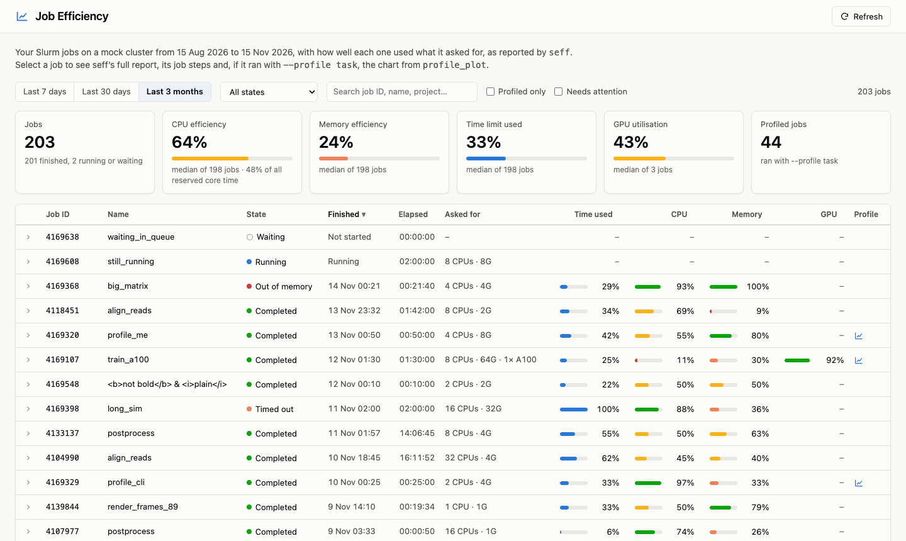
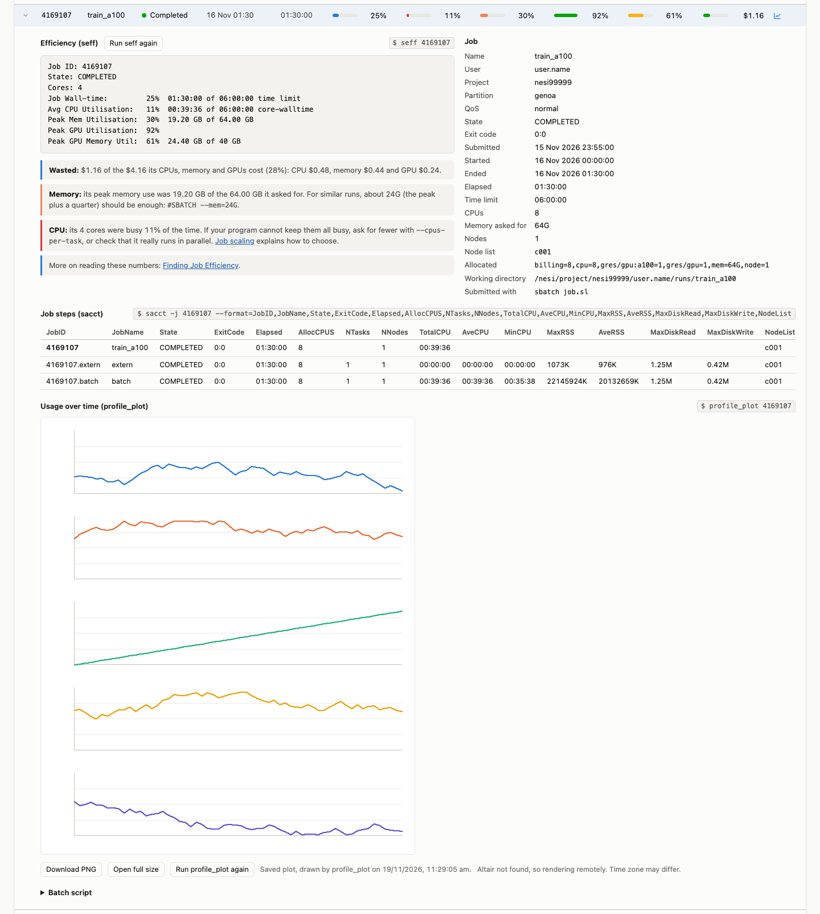

# Job Efficiency (Efficiency Reporter)

An Open OnDemand app that shows how well each of your Slurm jobs from the last
three months used the CPUs, memory, time and GPUs it asked for, as reported by
`seff`. Select a job to see `seff`'s full report, `sacct`'s view of the job and
its steps, its batch script and, if it ran with `--profile task`, the chart
`profile_plot` draws of its use over time.





*(Screenshots from the mock cluster in `test/mock_cluster`, so the plot is a
stand-in. On Mahuika it is the chart `profile_plot` makes.)*

## What it shows

- **A short report for every job**: state, when it finished, how long it ran,
  what it asked for, and `seff`'s figures for time limit used, CPU, memory, GPU
  and GPU memory use, each as a number with a small meter (green, amber, orange
  or red for CPU, memory, GPU and GPU memory). Sort by any column; filter by
  date range, state (all finished jobs at once, or one kind of ending), name
  or ID, profiled jobs only, or jobs that need attention. The table's header
  stays in view as you scroll down.
- **A summary** of the jobs shown: the median of each figure, and the share of
  all reserved core time the jobs used.
- **The full report for any job**, when you select it:
  - `seff`'s report, exactly as printed, with short pointers drawn from it
    (for example a suggested `--mem`), following NeSI's
    [Finding Job Efficiency](https://docs.nesi.org.nz/Software/Profiling_and_Debugging/Finding_Job_Efficiency/) guidance;
  - the job's details and its job steps from `sacct`;
  - the plot from `profile_plot`, if the job ran with `--profile task`
    ([Slurm Native Profiling](https://docs.nesi.org.nz/Software/Profiling_and_Debugging/Slurm_Native_Profiling/)),
    with a download link;
  - the job's batch script.

Each section shows the command it came from (`seff 1234567`,
`profile_plot 1234567`, ...), so users can run the same thing in a terminal.

## How it works

`seff`, `profile_plot` and `sacct` are the source of truth. The app runs them as
the logged-in user and shows what they print. It never works out efficiency
itself: the list only picks the percentages out of `seff`'s own lines, matched
loosely so that a change to `seff`'s wording does not break it.

1. **`sacct`** lists the user's jobs over the last `history_months`
   (`remote/list_jobs.sh`), in three steps that start at once: the last 7
   days, the last 30 days and the whole history. Each step's jobs are shown as
   soon as `sacct` returns them, so recent jobs can be looked at (and `seff`
   starts on them) while older ones are still being listed; a range still being
   listed shows a small spinner.
2. **`seff`** is run in the background on the finished jobs it has no saved
   report for, one call at a time, starting with the most recent jobs and
   working back: 20 jobs in the first call, so the newest figures appear
   quickly, then about 100 per call (`seff` reports on every job it is given,
   one after another). The list fills in as the reports arrive
   (`remote/seff.sh`). If `seff` fails part-way through a call, the jobs it had
   reported on are kept and the rest are run one at a time, so one job `seff`
   cannot report on never hides the others. The same call reads the jobs'
   batch scripts (`sacct --batch-script`) for `--profile`, so the list can mark
   profiled jobs.
3. **Opening a job** runs `sacct` and `seff` on it again, and `sacct
   --batch-script` (`remote/job_details.sh`). If it ran with `--profile task`,
   `profile_plot JOBID` is run in an empty temporary directory and the image it
   writes is shown (`remote/profile_plot.sh`). For other jobs there is a
   "Run profile_plot anyway" button.

The app is built like Slurm Composer: a Sinatra app, with its settings in
`conf.yml.erb`. On Mahuika the OnDemand host is not a Slurm client, so, as in
Slurm Composer, the commands run on a login node as the user, with
`ssh_wrapper` put in front of them. Each script is sent base64-encoded and run
with `bash -s`, and its output comes back in marked sections, so whatever the
user's shell start-up files print is ignored. Any temporary files a script
makes on the login node go in one folder, which is removed however the script
ends, even if it is cut off part-way.

Passwordless SSH is set up exactly as Slurm Composer does it, with the same
settings and the same key (`~/.ssh/opencomposer_ed25519`), so the two apps
share it. On the first page view the app checks that the user has a key in
`~/.ssh/authorized_keys`. If not, it makes a passphrase-less key of its own,
authorises it, and adds an `IdentityFile` line for it to `~/.ssh/config`. Home
directories are shared with the login nodes, so that is all `ssh` needs. A key
the user already owns is never authorised on their behalf.

`seff`'s reports and `profile_plot`'s plots for finished jobs are saved in an
SQLite database in the user's `data_dir` (`efficiency_reporter.db`, tables
`seff_reports` and `profile_plots`), as Slurm Composer keeps its job history.
Opening the app again only runs `seff` on jobs it has not reported on yet, and
a saved plot opens without running `profile_plot` again. Only clean results for
jobs that finished more than 10 minutes ago are saved, so that the last of
their accounting has reached Slurm's database. Each row is saved with a
checksum of the program that made it, and rows from a different `seff` or
`profile_plot` are dropped, so a change to either on the cluster shows up
straight away. Opening a job always runs `seff` on it again; a saved plot has a
"Run profile_plot again" button; and "About these numbers", at the bottom of
the page, can forget everything saved. Each batch is saved in one transaction,
so an interrupted save leaves the database as it was.

## Requirements

- Open OnDemand 3 or later, with the gems in `misc/Gemfile` (`sinatra`,
  `sinatra-contrib`, `rackup`, `sqlite3`, `webrick`): the same as Slurm
  Composer. Where Slurm Composer runs, these are already installed. Without
  `sqlite3` the app still works, but runs `seff` on every job on each visit.
- `ssh`, `ssh-keygen` and `bash` on the OnDemand host, with home directories
  shared with the login nodes.
- On the login nodes: `sacct`, `seff` and `profile_plot` (from `/opt/nesi/bin`),
  `bash`, `base64` and `mktemp`.

## Installing

As a system app, for everyone:

```sh
sudo git clone <this repository> /var/www/ood/apps/sys/efficiency_reporter
```

It then appears under **Jobs** in the OnDemand menus. The URL is
`/pun/sys/efficiency_reporter`. If the gems are not already installed (for
Slurm Composer), install them as Slurm Composer's instructions do:

```sh
cd /var/www/ood/apps/sys/efficiency_reporter
sudo cp misc/Gemfile .
sudo bundle install
```

To try it first as yourself, if App Development is enabled for you in OnDemand,
use your sandbox instead:

```sh
git clone <this repository> ~/ondemand/dev/efficiency_reporter
```

Then open `/pun/dev/efficiency_reporter`, or **Develop → My Sandbox Apps**.

After changing the Ruby code or the page template, restart the app: **Help →
Restart Web Server**, or `touch tmp/restart.txt`. Changes to `conf.yml.erb`,
`public/` and `remote/` need no restart.

## Configuration

`conf.yml.erb` holds the settings for Mahuika. As in Slurm Composer it is YAML
run through ERB first, so values can use `ENV`. Every setting has a default.

| Setting | Mahuika value | What it does |
|---|---|---|
| `login_node` | `login.hpc.nesi.org.nz` | The host the commands run on, as shown on the page. |
| `ssh_wrapper` | `ssh -o BatchMode=yes -o ConnectTimeout=20 login.hpc.nesi.org.nz` | Put in front of every command, as in Slurm Composer. `""` runs them on the OnDemand host. BatchMode stops `ssh` from ever waiting for a password. |
| `ensure_ssh_key`, `ssh_key_type`, `ssh_key_name` | `true`, `ed25519`, `opencomposer` | Slurm Composer's SSH key check (see above). With the same values as Slurm Composer, the two apps share one key. |
| `data_dir` | `~/ondemand/data/sys/efficiency_reporter` | Where each user's saved `seff` reports and profile plots are kept (`efficiency_reporter.db`). |
| `commands` | `sacct`, `seff`, `profile_plot` | The commands, exactly as a user would type them. |
| `extra_path` | `/opt/nesi/bin` | Added to the end of `PATH` on the login node. |
| `history_months` | `3` | How many months of jobs to show. |
| `seff_batch_size` | `100` | Jobs per `seff` call (`seff` gives its one `sacct` call 30 seconds). |
| `detect_profiling` | `true` | Search batch scripts for `--profile` to mark profiled jobs in the list. |
| `command_timeout` | `120` | Seconds any one command may take. |
| `thresholds` | `70 / 40 / 20` | Percentages at which a figure turns from green to amber, orange and red. |
| `cluster_name`, `docs` | | Text and links shown on the page. |

## Checking it on Mahuika

`tools/check_on_mahuika.sh` runs the scripts in `remote/` on a login node
exactly as the app does, and prints a short summary of what each returned. It
only reads.

```sh
bash tools/check_on_mahuika.sh            # uses some of your recent jobs
bash tools/check_on_mahuika.sh 12345678   # also opens this job, e.g. one run with --profile task
```

## Developing

`test/run_local.sh` runs the app on your own computer, without Slurm or
OnDemand, against a mock cluster:

- `test/mock_cluster/bin/sacct` and `profile_plot` are mocks, serving the
  made-up jobs in `test/mock_cluster/jobs.py`;
- `seff` is NeSI's real one (`nn_seff`, fetched from
  [nesi/opt-nesi-bin](https://github.com/nesi/opt-nesi-bin) on first use), run
  against the mock `sacct`.

```sh
gem install sinatra sinatra-contrib rackup sqlite3 webrick   # once (misc/Gemfile)
test/run_local.sh                                            # then open http://localhost:9393/
ruby test/test_app.rb                                        # the tests (the API tests need test/run_local.sh to have run once)
```

`test/run_local.sh` runs Sinatra in development mode, so changes to `lib/` are
picked up without a restart.

The mock jobs cover completed, failed, out-of-memory, timed-out, cancelled,
running and pending jobs, a job array, GPU and multi-node jobs, profiled jobs, a
job `seff` cannot report on, and job names that must be shown as text.

## Files

```
manifest.yml            OnDemand app tile: name, category, icon
config.ru, run.rb       the Sinatra app: the page and its JSON API
conf.yml.erb            site settings
misc/Gemfile            the gems the app needs
lib/
  conf.rb               reads conf.yml.erb
  ssh_key.rb            Slurm Composer's SSH key check
  command_runner.rb     runs the remote/ scripts through ssh_wrapper (or locally), with a time limit
  sacct.rb              reads sacct's output
  seff.rb               reads seff's output; runs seff in batches, with the fallback
  profiling.rb          finds --profile in batch scripts and submit lines
  report_store.rb       the saved seff reports and profile plots (SQLite)
remote/                 the bash scripts run on the login node
views/index.erb         the page
public/assets/          the page's JavaScript, CSS and icon
tools/                  check_on_mahuika.sh
test/                   tests, the mock cluster and run_local.sh
```

## Notes

- NeSI's `seff` stops with `KeyError: 'mem'` on a job none of whose steps ran
  for any time (for example one that failed at once), part-way through printing
  that job's report. Given several jobs, it stops there, so the jobs after it
  get no report. The app runs the rest one at a time and shows `seff`'s error
  for that job instead of its figures.
- All text from the cluster (job names, scripts, `seff`'s output) is put on the
  page as text, never as HTML. Job IDs are checked before they reach a command.
